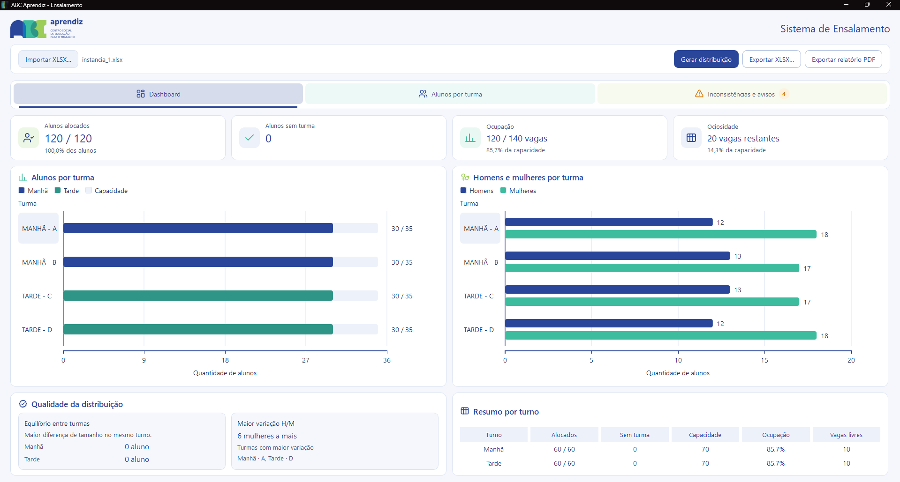

# ABC Aprendiz — Sistema de Ensalamento

Aplicativo desktop que distribui alunos em turmas de manhã e à tarde, respeitando a disponibilidade e a capacidade de cada turma. A distribuição também busca equilibrar a quantidade de alunos e alunas entre as turmas.



## ⬇️ Baixar o executável para Windows

### [Baixar `ABC_Aprendiz.exe` diretamente →](https://media.githubusercontent.com/media/ArthurDp78/Desafio_Unisoma/main/ABC_Aprendiz.exe)

É um arquivo único e não exige a instalação do Python. O GitHub Actions compila o `.exe` em um runner Windows e o adiciona ao repositório; o README aponta diretamente para o arquivo. Se o download ainda não estiver disponível logo após uma atualização, aguarde o workflow **Build Windows executable** terminar.

## O que o programa faz

- Importa uma planilha Excel com alunos e turmas.
- Valida os dados e avisa sobre campos incorretos ou nomes repetidos.
- Distribui alunos de acordo com o turno disponível e as vagas de cada turma.
- Mostra o resultado em um painel com gráficos, indicadores e filtros.
- Exporta a planilha preenchida e um relatório em PDF.

Se não houver vagas suficientes, o programa identifica os alunos que ficaram sem turma. A planilha original é preservada; os resultados são gravados em um arquivo de saída.

## Usar o programa

1. Clique em [Baixar `ABC_Aprendiz.exe`](https://media.githubusercontent.com/media/ArthurDp78/Desafio_Unisoma/main/ABC_Aprendiz.exe).
2. Abra o arquivo. Não é necessário instalar Python.
3. Clique em **Importar XLSX** e selecione a planilha.
4. Clique em **Gerar distribuição**.
5. Confira os resultados e use **Exportar XLSX** ou **Exportar relatório PDF**.

O botão **Manual do usuário** abre o guia completo. Uma versão do manual também está disponível em [`outputs/pdf/manual_usuario.pdf`](outputs/pdf/manual_usuario.pdf).

## Preparar a planilha de entrada

O arquivo `.xlsx` deve ter duas abas com estes nomes e cabeçalhos:

### Aba `Alunos`

| Coluna | Valores esperados |
|---|---|
| `Nome` | Nome do aluno |
| `Sexo` | `M` ou `F` |
| `Disponibilidade` | `Manhã` ou `Tarde` |

Variações simples, como `masculino`, `feminino`, `manha` ou espaços extras, são normalizadas e indicadas como avisos. Registros sem nome, sexo ou disponibilidade válidos não entram na distribuição. Linhas totalmente vazias são ignoradas.

### Aba `Turmas`

| `Recursos` | `Quantidade` |
|---|---:|
| `turmas_manha` | Número de turmas de manhã |
| `turmas_tarde` | Número de turmas à tarde |
| `vagas_manha` | Vagas por turma de manhã |
| `vagas_tarde` | Vagas por turma à tarde |

Os quatro recursos são obrigatórios e devem ter quantidades inteiras positivas. O projeto inclui planilhas de exemplo na pasta [`Dados/`](Dados/), como [`instancia_1.xlsx`](Dados/instancia_1.xlsx).

## Arquivos gerados

- **Ensalamento**: lista de alunos e turma atribuída; quem não couber recebe `SEM TURMA`.
- **Inconsistências**: registros inválidos, valores normalizados, nomes repetidos e alunos sem vaga.
- **Relatório PDF**: resumo, gráficos, indicadores e relação de alunos por turma.

Ao exportar, as abas de entrada e outras abas existentes na planilha são mantidas.

## Rodar pelo código-fonte

Para executar a aplicação a partir do código, use Windows e Python **3.12.9**. Abra o PowerShell na pasta do projeto e rode:

```powershell
py -3.12 -m venv .venv
.venv\Scripts\python.exe -m pip install --upgrade pip
.venv\Scripts\python.exe -m pip install -r requirements.txt
.venv\Scripts\python.exe ensalamento.py
```

Também é possível abrir `executar.bat`. Se as dependências já estiverem instaladas, o script inicia o executável compilado quando ele existe; caso contrário, tenta iniciar o programa com o ambiente Python disponível.

Para usar uma planilha específica pelo terminal:

```powershell
.venv\Scripts\python.exe ensalamento.py "C:\caminho\para\instancia.xlsx"
```

<a id="criar-executavel-do-windows"></a>
## Criar o executável do Windows

Na pasta do projeto, instale as dependências de compilação e gere o pacote:

```powershell
.venv\Scripts\python.exe -m pip install -r requirements-dev.txt
.venv\Scripts\python.exe -m playwright install chromium --only-shell
.venv\Scripts\python.exe -m PyInstaller --noconfirm ABC_Aprendiz.spec
```

Ou, depois de instalar `requirements-dev.txt`, abra `gerar_executavel.bat`. O arquivo pronto será criado em:

```text
dist/ABC_Aprendiz.exe
```

O executável deve ser compilado no Windows. O workflow do GitHub Actions faz isso após alterações na branch `main` e grava o resultado como `ABC_Aprendiz.exe` na raiz do repositório. Esse arquivo usa Git LFS para permitir o armazenamento de binários grandes. O build atual não tem assinatura digital, então o Windows pode mostrar um aviso de editor desconhecido.

## Tecnologias

- Python, pandas e openpyxl para leitura e gravação de planilhas.
- PuLP com o solver CBC para otimização.
- PySide6 para a interface desktop.
- PyInstaller para criar o executável do Windows.

## Testes

Com as dependências instaladas, execute:

```powershell
.venv\Scripts\python.exe -m unittest discover -s tests -v
```

## Estrutura do projeto

```text
assets/        imagens, ícones e capturas do manual
Contexto/      documentos do desafio
Dados/         planilhas de exemplo
ui/            interface e recursos visuais
tests/         testes automatizados
ensalamento.py leitura, validação, modelo e exportação
apresentacao.py adaptação dos resultados para a interface
relatorio_pdf.py geração do relatório em PDF
README.md      instruções do projeto
```
